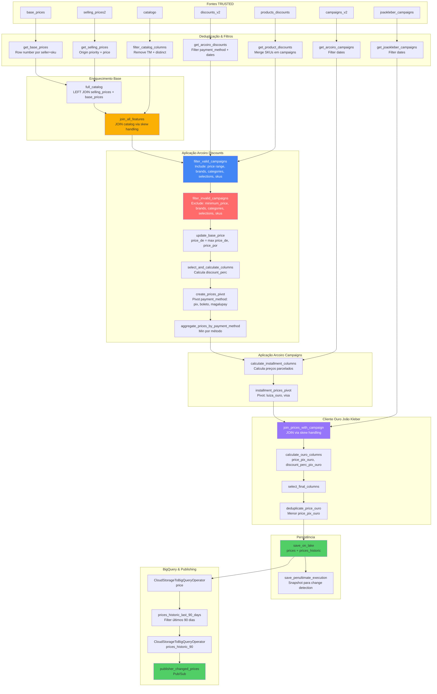
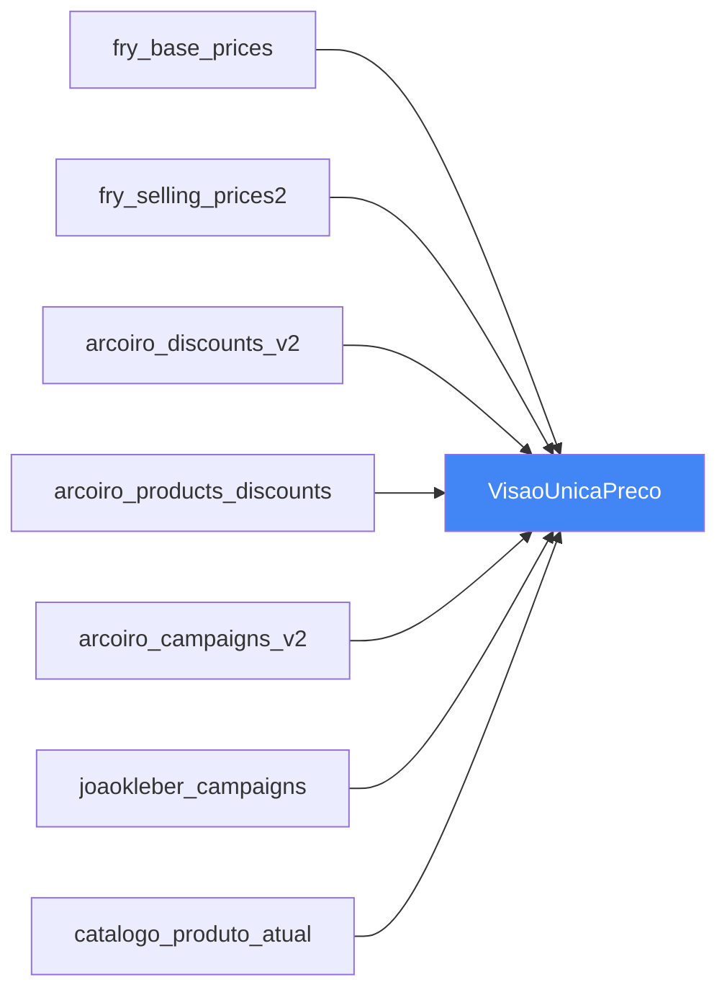
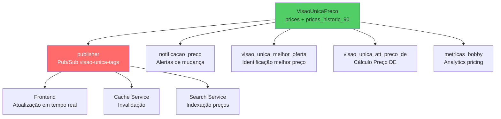

# Pipeline Visão Única Preço

## 📋 Índice
- [Objetivo](#-objetivo)
- [Dono Técnico](#-dono-técnico)
- [Fontes e Destinos](#-fontes-e-destinos)
- [Fluxo Técnico](#-fluxo-técnico)
- [Regras de Negócio](#-regras-de-negócio)
- [Configurações](#%EF%B8%8F-configurações)
- [Relacionamento com Outros Pipelines](#-relacionamento-com-outros-pipelines)
- [Casos de Uso](#-casos-de-uso)
- [Monitoramento](#-monitoramento)
- [Referências](#-referências)

---

## 🎯 Objetivo

Pipeline **PRINCIPAL** da Visão Única, consolidando **preços de múltiplas fontes** (FRY + Arcoiro + João Kleber) em uma única tabela analítica. Combina base prices, selling prices, campanhas de desconto (discounts_v2, products_discounts, campaigns_v2, joaokleber_campaigns) e catálogo para entregar **visão 360° de preços por método de pagamento**.

**Características:**
- ✅ **Execução horária** (`:25` de cada hora - PRD)
- ✅ **3 tasks principais** (trusted_prices, histórico 90 dias, publisher)
- ✅ **2 tabelas BigQuery** (price + prices_historic_90)
- ✅ **Pub/Sub publisher** (mudanças de preço)
- ✅ **Skew handling** (join_solve_imbalancing para sellers com muitos SKUs)

---

## 👥 Dono Técnico

- **Squad:** AI Growth
- **Tribo:** Data Products
- **Namespace:** `visao_unica`
- **DAG:** VisaoUnicaPreco
- **Ambiente de Produção:** [Critical (GCP)](https://31c5efd94119490bb4cb9f8673a79a42-dot-us-east1.composer.googleusercontent.com/dags/VisaoUnicaPreco/grid?search=VisaoUnicaPreco) **Ligada**
- **Ambiente de Staging:** [Staging New (GCP)](https://0b42fb7cba9a46e6855676d6b60bd40e-dot-us-east1.composer.googleusercontent.com/dags/VisaoUnicaPreco/grid?search=VisaoUnicaPreco) **Desligada**
- **Schedule:** Horário minuto 25 (`25 * * * *`) - apenas PRD
- **Datasets:**
  - `prices` (REFINED - atual)
  - `prices_historic` (REFINED - histórico completo)
  - `prices_historic_last_90_days` (REFINED - últimos 90 dias)
  - `prices_penultimate_execution` (REFINED - snapshot anterior para change detection)

---

## 📥 Fontes e Destinos

### Fontes (TRUSTED Zone)

| Dataset | Descrição | Deduplicação |
|---------|-----------|--------------|
| `visao_unica.base_prices` | Preços DE (list_price) do FRY | Row number por (seller_id, sku) - timestamp_kafka desc |
| `visao_unica.selling_prices2` | Preços POR (selling price) do FRY | Origin priority + price asc por seller+sku |
| `visao_unica.discounts_v2` | Campanhas de desconto Arcoiro (payment_method based) | Row number por id - timestamp_kafka desc |
| `visao_unica.products_discounts` | SKUs específicos em campanhas Arcoiro | Merge com discounts_v2 |
| `visao_unica.campaigns_v2` | Campanhas Arcoiro (installment plans) | Row number por id - timestamp_kafka desc |
| `visao_unica.joaokleber_campaigns` | Campanhas João Kleber (seller+sku specific) | Sem dedup (já consolidado) |
| `catalogo.visao_catalogo_produto_atual` | Catálogo de produtos (navigation_id, brand, category_id, active, stock) | Distinct por (seller_id, sku, navigation_id) |

**Campos Principais:**

**base_prices:**
```python
df.select(
    'seller_id',
    'sku',
    'list_price',           # Renomeado para preco_de
    'timestamp_kafka',
    'selections',
    'currency'              # Default: BRL
)
```

**selling_prices2 (Filtros):**
```python
df.filter(
    (col("channel_id") == '*')                     # Todos os canais
    & (col("campaign_code").isin(["0", "8349"]))  # Parceiro zero ou 8349
    & col("deleted_at").isNull()                   # Não deletados
    & current_timestamp().between("start_at", "end_at")  # Válidos agora
)

# Origin Priority (menor = maior prioridade):
# 1. acme-admin-priority
# 2. kratos
# 3. acme-admin
# 4. adm-site
# 5. promo3p
# 6. integra
# 7. api
```

**discounts_v2 (Filtros):**
```python
df.filter(
    col("payment_method").isin(["pix", "boleto", "account_balance", "luiza_ouro", "visa"])
    & col("deleted_at").isNull()
    & current_timestamp().between("start_date", "end_date")
)
```

**campaigns_v2 (Filtros):**
```python
df.filter(
    current_timestamp().between("start_date", "end_date")
    & col("deleted_at").isNull()
)
```

**catálogo (Filtros):**
```python
df.filter(
    col("category_id") != "TM"  # Remove produtos temporários
).select(
    "seller_id", "sku", "navigation_id", "brand", 
    "category_id", "active", "stock"
).distinct()
```

---

### Destinos

#### 1. **GCS REFINED (Tabelas Principais)**

**Dataset:** `prices`
```
gs://prd-lake-refined-visao_unica/prices/price_date=YYYY-MM-DD/
```

**Schema Consolidado:**
```python
columns = [
    # Identificadores
    "seller_id",              # STRING
    "sku",                    # STRING
    "navigation_id",          # STRING
    
    # Flags de disponibilidade
    "active",                 # BOOLEAN - produto ativo
    "stock",                  # BOOLEAN - possui estoque
    
    # Preços base
    "price_de",               # DECIMAL(8,2) - Preço DE (list_price)
    "price_por",              # DECIMAL(8,2) - Preço POR (selling_price)
    
    # Preços por método de pagamento (Arcoiro discounts_v2)
    "price_pix",              # DECIMAL(8,2) - Preço no Pix
    "price_boleto",           # DECIMAL(8,2) - Preço no Boleto
    "price_magalupay",        # DECIMAL(8,2) - Preço no MagaluPay (account_balance)
    
    # Preços parcelados (Arcoiro campaigns_v2)
    "installment_price_once_luiza",  # DECIMAL(8,2) - Parcelado Luiza Ouro
    "installment_price_once_visa",   # DECIMAL(8,2) - Parcelado Visa
    
    # Descontos percentuais
    "discount_perc_pix",      # DECIMAL(8,2) - % desconto Pix vs price_por
    
    # Cliente Ouro (João Kleber campaigns)
    "price_por_ouro",         # DECIMAL(8,2) - Preço POR para cliente ouro
    "price_pix_ouro",         # DECIMAL(8,2) - Preço PIX para cliente ouro
    "discount_perc_pix_ouro", # DECIMAL(8,2) - % desconto PIX cliente ouro
    
    # Identificadores de campanha
    "campaign_code",          # STRING - Código da campanha (0, 8349, etc)
    "id_discounts",           # STRING - ID da campanha Arcoiro discounts_v2
    
    # Temporal
    "price_date"              # DATE - Data de processamento (partição)
]
```

**Particionamento:** `price_date` (DATE)

**Mode:** Definido por variável Airflow `writing_mode_visao_preco` (append ou overwrite)

---

#### 2. **GCS REFINED (Histórico)**

**Dataset:** `prices_historic`
```
gs://prd-lake-refined-visao_unica/prices_historic/price_date=YYYY-MM-DD/
```

**Modo:** APPEND (acumula histórico completo)

**Dataset:** `prices_historic_last_90_days`
```
gs://prd-lake-refined-visao_unica/prices_historic_last_90_days/price_date=YYYY-MM-DD/
```

**Filtro:** Últimos `days_to_process_prices_historic_to_bq` dias (padrão: 90)

**Modo:** OVERWRITE (janela deslizante de 90 dias)

---

#### 3. **GCS REFINED (Change Detection)**

**Dataset:** `prices_penultimate_execution`
```
gs://prd-lake-refined-visao_unica/prices_penultimate_execution/
```

**Modo:** OVERWRITE (snapshot da execução anterior)

**Função:** Change detection via LEFT JOIN para identificar mudanças de preço.

---

#### 4. **BigQuery (Tabelas Analíticas)**

**Tabela:** `visao_unica.price`
- **Origem:** `prices` (REFINED)
- **Modo:** OVERWRITE
- **Partição:** `price_date` (DAY)
- **Clustering:** Nenhum

**Tabela:** `visao_unica.prices_historic_90`
- **Origem:** `prices_historic_last_90_days` (REFINED)
- **Modo:** OVERWRITE
- **Partição:** `price_date` (DAY)
- **Clustering:** `price_date`

---

#### 5. **Google Cloud Pub/Sub**

**Tópico:** `magalu-digital-project/visao-unica-tags`

**Mensagem Publicada (change detection):**
```json
{
  "payload": {
    "navigation_id": "NAV123456",
    "sku": "789012",
    "seller_id": "1",
    "price_de": 150.00,
    "price_por": 120.00,
    "price_pix": 108.00,
    "price_boleto": 114.00,
    "price_magalupay": 108.00
  },
  "tag": "prices"
}
```

**Atributos:**
```python
attributes = {"tag": "prices"}
```

**Flow Control:**
```python
flow_control = PublishFlowControl(
    message_limit=15000,
    byte_limit=5 * 1024 * 1024,  # 5 MB
    limit_exceeded_behavior=LimitExceededBehavior.BLOCK,
)
```

**Detecção de Mudança (SQL):**
```sql
-- Publica se houver diferença em qualquer preço (threshold: R$ 0.01)
WHERE 
    COALESCE(penultimate.price_de, 0) != COALESCE(ultimate.price_de, 0) OR
    COALESCE(penultimate.price_por, 0) != COALESCE(ultimate.price_por, 0) OR
    COALESCE(penultimate.price_pix, 0) != COALESCE(ultimate.price_pix, 0) OR
    COALESCE(penultimate.price_boleto, 0) != COALESCE(ultimate.price_boleto, 0) OR
    COALESCE(penultimate.price_magalupay, 0) != COALESCE(ultimate.price_magalupay, 0) OR
    COALESCE(penultimate.price_por_ouro, 0) != COALESCE(ultimate.price_por_ouro, 0) OR
    COALESCE(penultimate.price_pix_ouro, 0) != COALESCE(ultimate.price_pix_ouro, 0)
```

---

## 🏗️ Fluxo Técnico



---

### Tasks Airflow (DAG: VisaoUnicaPreco)

| Task | Tipo | Executor | Instances | Max | Descrição |
|------|------|----------|-----------|-----|-----------|
| `trusted_prices` | MinecraftOperator | **ULTRA_LARGE** | 12 | 20 | Consolida preços de todas fontes |
| `bq_prices` | CloudStorageToBigQueryOperator | - | - | - | prices → BigQuery.price |
| `prices_historic_last_90_days` | MinecraftOperator | **ULTRA_LARGE** | 12 | 20 | Filtra últimos 90 dias do histórico |
| `bq_prices_historic` | CloudStorageToBigQueryOperator | - | - | - | prices_historic_last_90_days → BigQuery.prices_historic_90 |
| `publisher` | MinecraftOperator | **LARGE** | - | 4 | Pub/Sub (mudanças de preço) |

### Fluxo de Execução
```
trusted_prices 
  → bq_prices 
    → prices_historic_last_90_days 
      → bq_prices_historic 
        → publisher
```

### Variáveis Airflow
```python
WRITING_MODE = Variable.get("writing_mode_visao_preco")  # append ou overwrite
DAYS_TO_PROCESS = Variable.get("days_to_process_prices_historic_to_bq")  # default: 90
```

---

## 📜 Regras de Negócio

### 1. **Deduplicação de Base Prices**

```python
def get_base_prices(ss, environment):
    df = ss.read.parquet(environment, "trusted", "visao_unica", "base_prices")
    
    # Deduplica por seller+sku (mais recente)
    df = (
        df.select(
            'seller_id', 'sku', 'list_price', 'timestamp_kafka', 
            'selections', 'currency',
            sf.row_number()
            .over(Window.partitionBy("seller_id", "sku")
                  .orderBy(sf.col("timestamp_kafka").desc()))
            .alias("pos")
        )
        .filter(sf.col("pos") == 1)
        .drop("pos")
    )
    
    # Default currency = BRL
    df = df.withColumn("currency", sf.coalesce(sf.col("currency"), sf.lit("BRL")))
    
    return df.withColumnRenamed("list_price", "preco_de")
```

---

### 2. **Deduplicação de Selling Prices (Origin Priority)**

```python
def get_selling_prices(ss, environment):
    df = ss.read.parquet(environment, "trusted", "visao_unica", "selling_prices2")
    
    # 1. Remove deletados (última operação por _id.$oid)
    df = df.withColumn(
        "rank_actions",
        sf.row_number().over(
            Window.partitionBy("_id.$oid").orderBy(sf.desc("timestamp_kafka"))
        )
    ).filter(sf.col("rank_actions") == 1)
    
    df = df.filter(sf.col("op") != 'd')
    
    # 2. Filtros de validade
    df = df.filter(
        sf.col("deleted_at").isNull()
        & sf.current_timestamp().between(sf.col("start_at"), sf.col("end_at"))
    )
    
    # 3. Filtro de parceiro (channel=* e campaign_code in [0, 8349])
    df = df.filter(
        (sf.col("channel_id") == '*')
        & (sf.col("campaign_code").isin(["0", "8349"]))
    )
    
    # 4. Origin priority (menor número = maior prioridade)
    ORIGIN_PRIORITY = [
        ("acme-admin-priority", 1),
        ("kratos", 2),
        ("acme-admin", 3),
        ("adm-site", 4),
        ("promo3p", 5),
        ("integra", 6),
        ("api", 7),
    ]
    
    origin_rank_col = None
    for origin, priority in ORIGIN_PRIORITY:
        if origin_rank_col is None:
            origin_rank_col = sf.when(sf.col("origin") == origin, sf.lit(priority))
        else:
            origin_rank_col = origin_rank_col.when(sf.col("origin") == origin, sf.lit(priority))
    
    df = df.withColumn("origin_priority", origin_rank_col)
    
    # 5. Deduplica por seller+sku (origin priority + menor preço)
    df = df.withColumn(
        "price_rank",
        sf.row_number().over(
            Window.partitionBy("id")
            .orderBy(sf.asc("origin_priority"), sf.asc("price"))
        )
    ).filter(sf.col("price_rank") == 1)
    
    return df.withColumnRenamed("price", "preco_por")
```

**Exemplo:**
```
Seller 1, SKU 123:
- Origin: api, Price: 100 → priority=7
- Origin: kratos, Price: 105 → priority=2
- Origin: acme-admin-priority, Price: 110 → priority=1

Resultado: acme-admin-priority (priority=1 vence, mesmo com preço maior)
```

---

### 3. **Filtro de Produtos Temporários (Catálogo)**

```python
def filter_catalog_columns_to_price_and_distinct(df):
    columns = [
        "seller_id", "sku", "navigation_id", 
        "brand", "category_id", "active", "stock"
    ]
    
    # Remove produtos category_id = 'TM' (temporários)
    df = df.select(columns).filter(sf.col("category_id") != "TM").distinct()
    
    return df
```

---

### 4. **Aplicação de Campanhas Arcoiro Discounts (Include/Exclude)**

#### **filter_valid_campaigns (Inclusão)**

```python
def filter_valid_campaigns(df, discounts, prices):
    # 1. Price range
    price_range_condition = sf.when(
        (sf.col("target.include.price.min") != 0) | (sf.col("target.include.price.max") != 0),
        sf.col("preco_por").between(
            sf.col("target.include.price.min"), 
            sf.col("target.include.price.max")
        )
    ).otherwise(sf.lit(True))
    
    # 2. All products (se arrays vazios = todos produtos)
    all_products_condition = (
        (sf.size("target.include.skus") == 0)
        & (sf.size("target.include.brands") == 0)
        & (sf.size("target.include.selections") == 0)
        & (sf.size("target.include.categories") == 0)
    )
    
    # 3. Include por atributos
    include_brands = sf.array_contains(discounts["target.include.brands"], prices.brand)
    include_categories = sf.array_contains(discounts["target.include.categories"], prices.category_id)
    include_selections = sf.size(sf.array_intersect(
        discounts["target.include.selections"], prices["selections"]
    )) >= 1
    include_skus = sf.array_contains(discounts["target.include.skus"], prices.sku)
    
    # Combina condições
    final_condition = price_range_condition & (
        all_products_condition | include_brands | include_categories | 
        include_selections | include_skus
    )
    
    return df.filter(final_condition)
```

#### **filter_invalid_campaigns (Exclusão)**

```python
def filter_invalid_campaigns(df, discounts, prices):
    # Campanhas sem filtros e sem preços definidos (inválidas)
    invalid_campaign_condition = (
        (sf.size("target.include.skus") == 0)
        & (sf.size("target.include.brands") == 0)
        & (sf.size("target.include.selections") == 0)
        & (sf.size("target.include.categories") == 0)
        & (sf.col("target.include.price.min").cast("int") == 0)
        & (sf.col("target.include.price.max").cast("int") == 0)
    )
    
    # Exclusões explícitas
    minimum_price_condition = sf.col("preco_por") < sf.col("target.exclude.minimum_price")
    exclude_brands = sf.array_contains(discounts["target.exclude.brands"], prices.brand)
    exclude_categories = sf.array_contains(discounts["target.exclude.categories"], prices.category_id)
    exclude_selections = sf.size(sf.array_intersect(
        discounts["target.exclude.selections"], prices["selections"]
    )) >= 1
    exclude_skus = sf.array_contains(discounts["target.exclude.skus"], prices.sku)
    
    # Remove campanhas inválidas ou explicitamente excluídas
    final_condition = ~(
        invalid_campaign_condition | minimum_price_condition | exclude_brands | 
        exclude_categories | exclude_selections | exclude_skus
    )
    
    return df.filter(final_condition)
```

---

### 5. **Atualização de Price DE (Regra de Consistência)**

```python
def update_base_price(df):
    """
    Se price_de < price_por ou NULL, ajusta price_de = price_por
    (garante que preço DE nunca seja menor que preço POR)
    """
    df = df.withColumn(
        "price_de",
        sf.when(
            (sf.col("price_de") < sf.col("price_por")) | sf.col("price_de").isNull(),
            sf.col("price_por")
        ).otherwise(sf.col("price_de"))
    )
    
    return df
```

---

### 6. **Cálculo de Preços por Método de Pagamento (Pivot)**

```python
def create_prices_pivot(df):
    """
    Pivot por payment_method, agregando menor price_discount.
    """
    return (
        df.groupBy(
            "seller_id", "sku", "navigation_id", "active", "stock",
            "campaign_code", "price_de", "price_por", "payment_method"
        )
        .pivot(
            "payment_method",
            ["pix", "boleto", "account_balance", "luiza_ouro", "visa"]
        )
        .agg(sf.min("price_discount"))
    )

def aggregate_prices_by_payment_method(df):
    """
    Agrupa e renomeia colunas pivotadas.
    """
    return df.groupBy(
        "seller_id", "sku", "navigation_id", "active", "stock",
        "campaign_code", "price_de", "price_por"
    ).agg(
        sf.min("pix").alias("price_pix"),
        sf.min("boleto").alias("price_boleto"),
        sf.min("account_balance").alias("price_magalupay"),
        sf.min("luiza_ouro").alias("installment_price_once_luiza"),
        sf.min("visa").alias("installment_price_once_visa")
    )
```

**Exemplo:**
```
Seller 1, SKU 123:
- payment_method=pix, discount=10% → price_discount=108.00
- payment_method=boleto, discount=5% → price_discount=114.00
- payment_method=account_balance, discount=10% → price_discount=108.00

Output:
price_pix=108.00, price_boleto=114.00, price_magalupay=108.00
```

---

### 7. **Cliente Ouro (João Kleber Campaigns)**

```python
def join_prices_with_campaign(df_prices, df_campaign):
    """
    JOIN com skew handling (sellers com muitos SKUs).
    Condição: (seller_id match + sku match) OR (seller_id match + sku='*')
    """
    join_condition = (
        (df_prices.seller_id == df_campaign.seller_ouro)
        & (df_prices.sku == df_campaign.sku_ouro)
        & (df_prices.skew == df_campaign.skew)
    ) | (
        (df_prices.seller_id == df_campaign.seller_ouro)
        & (df_campaign.sku_ouro == '*')  # Campanha aplica a todos SKUs do seller
        & (df_prices.skew == df_campaign.skew)
    )
    
    return df_prices.join(df_campaign, how='left', on=join_condition)

def calculate_ouro_columns(df):
    """
    Calcula preços cliente ouro.
    """
    # Percentual desconto Pix
    df = df.withColumn(
        "discount_perc_pix",
        sf.round(
            ((sf.col("price_por") - sf.col("price_pix")) / sf.col("price_por")) * 100, 2
        ).cast(DecimalType(8, 2))
    )
    
    # Preço com desconto cliente ouro
    df = df.withColumn(
        "price_pix_ouro",
        sf.when(
            sf.col("discount_ouro").isNotNull(),
            sf.round(
                sf.col("price_pix") * (1 - sf.col("discount_ouro") / 100), 2
            )
        ).otherwise(sf.col("price_pix"))
    ).cast(DecimalType(8, 2))
    
    # ... outros cálculos
    return df

def deduplicate_price_ouro(df):
    """
    Se múltiplas campanhas ouro, pega menor price_pix_ouro.
    """
    df = df.withColumn(
        "rank",
        sf.row_number().over(
            Window.partitionBy("seller_id", "sku", "navigation_id")
            .orderBy(sf.asc("price_pix_ouro"))
        )
    ).filter(sf.col("rank") == 1).drop("rank")
    
    return df
```

---

### 8. **Skew Handling (join_solve_imbalancing)**

```python
# Usado em 2 lugares: catalog join + joão kleber join
df_result = join_solve_imbalancing(
    df_to_hash=catalog,       # Lado pequeno (milhares de navigation_ids)
    df_to_explode=prices,     # Lado grande (milhões de seller+sku)
    how="inner",
    conditions=(catalog.seller_id == prices.seller_id) 
               & (catalog.sku == prices.sku),
    skew_multiply=10,
    columns_for_hashing=["seller_id", "sku"]
)
```

**Função:** Resolve data skew quando sellers têm volume muito desigual de SKUs (ex: seller 1 com 100k SKUs vs seller 2 com 10 SKUs).

---

### 9. **Config Spark (Disable AQE)**

```python
def config_spark_parallism(ss):
    """
    Desativa Adaptive Query Execution para evitar bottleneck de CPU.
    AQE reduzia muito o número de partições, causando skew.
    """
    ss.spark.conf.set("spark.sql.adaptive.enabled", "false")
    ss.spark.conf.set("spark.sql.adaptive.coalescePartitions.enabled", "false")
    ss.spark.conf.set("spark.sql.shuffle.partitions", 800)
    ss.spark.conf.set("spark.default.parallelism", 800)
    ss.spark.conf.set(
        "spark.sql.adaptive.skewJoin.skewedPartitionThresholdInBytes", "2MB"
    )
```

**Motivo:** Com AQE habilitado, partições caíam para <50, causando lentidão no processamento de milhões de registros.

---

## ⚙️ Configurações

### Scheduling
- **Produção:** Horário às :25 minutos (`25 * * * *`)
- **Staging:** Manual (`schedule_interval = None`)

### Retry Policy
- **Retries:** 1 tentativa
- **Delay:** 3 minutos

### Recursos Spark

| Task | Driver | Executor | Instances | Max Instances |
|------|--------|----------|-----------|---------------|
| trusted_prices | LARGE | ULTRA_LARGE | 12 | 20 |
| prices_historic_last_90_days | LARGE | ULTRA_LARGE | 12 | 20 |
| publisher | SMALL | LARGE | - | 4 |

### Spark Configuration
- **Adaptive Query Execution:** DISABLED
- **Shuffle Partitions:** 800
- **Default Parallelism:** 800
- **Skew Join Threshold:** 2MB

### Variáveis Airflow

```python
WRITING_MODE = Variable.get("writing_mode_visao_preco")
# Valores: "append" | "overwrite"
# Controla modo de escrita em prices e prices_historic

DAYS_TO_PROCESS = Variable.get("days_to_process_prices_historic_to_bq")
# Valor padrão: 90
# Controla janela de histórico (prices_historic_last_90_days)
```

---

## 🔗 Relacionamento com Outros Pipelines

### Upstream (Fontes - 8 pipelines)



**Dependências Críticas:**
- **base_prices + selling_prices2:** Essenciais (sem eles = tabela vazia)
- **discounts_v2 + campaigns_v2:** Importantes (sem eles = sem preços por método de pagamento)
- **joaokleber_campaigns:** Opcional (apenas cliente ouro)
- **catálogo:** Crítico (sem navigation_id = sem enriquecimento)

---

### Downstream (Consumidores)



---

## 💡 Casos de Uso

### 1. **Preço Atual de um Produto (Todos Métodos de Pagamento)**

```sql
SELECT 
  sku,
  seller_id,
  navigation_id,
  price_de,
  price_por,
  price_pix,
  price_boleto,
  price_magalupay,
  installment_price_once_luiza,
  installment_price_once_visa,
  discount_perc_pix,
  active,
  stock
FROM `visao_unica.price`
WHERE navigation_id = 'NAV123456'
  AND price_date = CURRENT_DATE()
ORDER BY price_pix ASC
LIMIT 1  -- Menor preço no Pix
```

---

### 2. **Comparação Cliente Regular vs Cliente Ouro**

```sql
SELECT 
  navigation_id,
  sku,
  seller_id,
  price_por,
  price_pix,
  price_por_ouro,
  price_pix_ouro,
  discount_perc_pix,
  discount_perc_pix_ouro,
  (price_pix - price_pix_ouro) as economia_cliente_ouro
FROM `visao_unica.price`
WHERE price_date = CURRENT_DATE()
  AND price_pix_ouro IS NOT NULL
ORDER BY economia_cliente_ouro DESC
LIMIT 100
```

---

### 3. **Evolução de Preço (90 dias)**

```sql
SELECT 
  price_date,
  AVG(price_pix) as avg_price_pix,
  MIN(price_pix) as min_price_pix,
  MAX(price_pix) as max_price_pix,
  STDDEV(price_pix) as volatility
FROM `visao_unica.prices_historic_90`
WHERE navigation_id = 'NAV123456'
  AND seller_id = '1'
GROUP BY price_date
ORDER BY price_date DESC
```

---

### 4. **Produtos com Maior Desconto no Pix Hoje**

```sql
SELECT 
  navigation_id,
  sku,
  seller_id,
  price_por,
  price_pix,
  discount_perc_pix,
  campaign_code,
  id_discounts
FROM `visao_unica.price`
WHERE price_date = CURRENT_DATE()
  AND discount_perc_pix > 30  -- >30% desconto
  AND active = TRUE
  AND stock = TRUE
ORDER BY discount_perc_pix DESC
LIMIT 100
```

---

### 5. **Validação price_de >= price_por (Regra de Negócio)**

```sql
-- Identifica violações da regra
SELECT 
  navigation_id,
  sku,
  seller_id,
  price_de,
  price_por,
  (price_de - price_por) as diferenca
FROM `visao_unica.price`
WHERE price_date = CURRENT_DATE()
  AND price_de < price_por  -- Violação da regra
ORDER BY diferenca
```

---

## 🚨 Monitoramento

### Validações Críticas

**1. Volume Total:**
```python
total_count = prices.count()
if total_count < 1_000_000:
    alert("CRÍTICO: Volume de preços muito baixo (<1M)")
```

**2. Taxa de Enriquecimento com Catálogo:**
```python
with_navigation_id = prices.filter(col("navigation_id").isNotNull()).count()
enrichment_rate = with_navigation_id / total_count

if enrichment_rate < 0.95:
    alert(f"WARNING: Apenas {enrichment_rate*100:.2f}% com navigation_id (esperado >95%)")
```

**3. Consistência price_de >= price_por:**
```python
inconsistent = prices.filter(col("price_de") < col("price_por")).count()
if inconsistent > 0:
    alert(f"ERROR: {inconsistent} registros com price_de < price_por")
```

**4. Produtos Ativos sem Preço Pix:**
```python
active_no_pix = prices.filter(
    col("active") & col("stock") & col("price_pix").isNull()
).count()

if active_no_pix > 10000:
    alert(f"WARNING: {active_no_pix} produtos ativos sem price_pix")
```

**5. Taxa de Publicação Pub/Sub:**
```python
changed_count = changed_prices.count()
total_count = prices.count()

change_rate = changed_count / total_count
if change_rate > 50.0:
    alert(f"WARNING: {change_rate}% de mudanças (esperado 5-15%)")
```

---

### Alertas Slack

```python
# Configurado em default_args
"on_failure_callback": slack_failed_task,
"slack_notification_channel": "integração-visao-unica"  # PRD
"slack_notification_channel": "integração-visao-unica-staging"  # STG
```

---

## 🔍 Troubleshooting

### Problema: Task falha com OOM (Out of Memory)

**Sintoma:**
```
WARN TaskSetManager: Lost task 123.0 in stage 5.0
java.lang.OutOfMemoryError: Java heap space
```

**Causa:** Skew em joins (sellers com volume muito desigual de SKUs).

**Solução:**
```python
# Já implementado via join_solve_imbalancing
# Verificar se skew_multiply está adequado (atual: 10)

# Se necessário, aumentar:
df = join_solve_imbalancing(
    df_to_hash=catalog,
    df_to_explode=prices,
    how="inner",
    conditions=...,
    skew_multiply=20,  # Aumentar de 10 para 20
    columns_for_hashing=["seller_id", "sku"]
)
```

---

### Problema: Execução muito lenta (>2h)

**Verificação:**
```python
# Verificar se AQE foi desabilitado corretamente
ss.spark.conf.get("spark.sql.adaptive.enabled")  # Deve ser "false"

# Verificar número de partições
ss.spark.conf.get("spark.sql.shuffle.partitions")  # Deve ser "800"
```

**Causa comum:** AQE reabilitado acidentalmente (reduz partições para <50).

**Solução:** Reexecutar `config_spark_parallism(ss)` no início do main().

---

### Problema: Muitos registros sem navigation_id

**Investigação:**
```sql
-- Identificar sellers/SKUs sem navegação
SELECT 
  seller_id, 
  COUNT(DISTINCT sku) as skus_sem_nav
FROM `visao_unica.price`
WHERE navigation_id IS NULL
  AND price_date = CURRENT_DATE()
GROUP BY seller_id
ORDER BY skus_sem_nav DESC
LIMIT 20
```

**Possíveis causas:**
- Catálogo desatualizado (produtos recém-lançados)
- Sellers 3P sem integração catálogo
- Produtos descontinuados (ainda têm preço mas saíram do catálogo)

---

### Problema: price_de < price_por (violação de regra)

**Verificação:**
```python
# Verificar se update_base_price foi executado
inconsistent = prices.filter(col("price_de") < col("price_por"))
inconsistent.show(20, truncate=False)
```

**Causa:** Função `update_base_price()` não foi chamada ou falhou silenciosamente.

**Solução:** Adicionar log antes e depois da função:
```python
logger.info(f"Antes update_base_price: {df.filter(col('price_de') < col('price_por')).count()} violações")
df = update_base_price(df)
logger.info(f"Após update_base_price: {df.filter(col('price_de') < col('price_por')).count()} violações")
```

---

## 📚 Referências

### Arquivos Principais
- **DAG:** `dags/main.py`
- **ETL Principal:** `etls/trusted/visao_precos.py` (1000+ linhas)
- **Histórico 90 dias:** `etls/trusted/prices_historic_last_90_days.py`
- **Publisher:** `etls/refined/publisher_changed_prices.py`
- **Validação Manual:** `etls/trusted/fetch_catalogo.py` (script debug)
- **Utils:** `../visao_unica_commons/etls/utils/utils.py`

### Funções Principais (visao_precos.py)

| Função | Linha | Descrição |
|--------|-------|-----------|
| `get_base_prices()` | 18-46 | Lê e deduplica base_prices |
| `get_selling_prices()` | 74-163 | Lê e deduplica selling_prices2 (origin priority) |
| `get_arcoiro_discounts()` | 246-328 | Lê e filtra discounts_v2 |
| `get_product_discounts()` | 49-71 | Merge products_discounts com discounts_v2 |
| `get_arcoiro_campaigns()` | 776-831 | Lê e filtra campaigns_v2 |
| `get_joaokleber_campaigns()` | 734-748 | Lê joaokleber_campaigns |
| `filter_catalog_columns()` | 166-179 | Filtra catálogo (remove TM) |
| `filter_valid_campaigns()` | 445-497 | Aplica regras include de campanhas |
| `filter_invalid_campaigns()` | 398-442 | Aplica regras exclude de campanhas |
| `update_base_price()` | 500-514 | Ajusta price_de se < price_por |
| `create_prices_pivot()` | 540-562 | Pivot payment_method |
| `aggregate_prices_by_payment_method()` | 565-583 | Agrupa preços por método |
| `join_prices_with_campaign()` | 586-603 | JOIN João Kleber via skew handling |
| `calculate_ouro_columns()` | 606-636 | Calcula preços cliente ouro |
| `deduplicate_price_ouro()` | 651-664 | Deduplica por menor price_pix_ouro |
| `calculate_installment_columns()` | 834-873 | Calcula parcelados |
| `installment_prices_pivot()` | 876-899 | Pivot parcelados |
| `config_spark_parallism()` | 330-342 | Desabilita AQE |
| `save_penultimate_execution()` | 345-360 | Snapshot para change detection |
| `main()` | 980-1100 | Orquestração principal |

---

### Datasets

| Dataset | Zona | Partição | Modo | Descrição |
|---------|------|----------|------|-----------|
| `visao_unica.base_prices` | TRUSTED | timestamp_kafka_day | - | Preços DE (FRY) |
| `visao_unica.selling_prices2` | TRUSTED | timestamp_kafka_day | - | Preços POR (FRY) |
| `visao_unica.discounts_v2` | TRUSTED | timestamp_kafka_day | - | Campanhas Arcoiro (payment_method) |
| `visao_unica.products_discounts` | TRUSTED | timestamp_kafka_day | - | SKUs em campanhas Arcoiro |
| `visao_unica.campaigns_v2` | TRUSTED | timestamp_kafka_day | - | Campanhas Arcoiro (parcelados) |
| `visao_unica.joaokleber_campaigns` | TRUSTED | - | - | Campanhas cliente ouro |
| `catalogo.visao_catalogo_produto_atual` | TRUSTED | - | - | Catálogo produtos |
| `visao_unica.prices` | REFINED | price_date | Variável | Tabela principal consolidada |
| `visao_unica.prices_historic` | REFINED | price_date | APPEND | Histórico completo |
| `visao_unica.prices_historic_last_90_days` | REFINED | price_date | OVERWRITE | Janela 90 dias |
| `visao_unica.prices_penultimate_execution` | REFINED | - | OVERWRITE | Snapshot anterior |

---

### Dependências
- **Sness-lib:** Framework interno
- **PySpark:** 3.x
- **google-cloud-pubsub:** 2.x (publisher)
- **Pub/Sub Topic:** `magalu-digital-project/visao-unica-tags`
- **BigQuery Tables:** `visao_unica.price`, `visao_unica.prices_historic_90`

---

**Última Atualização:** Novembro 2025  
**Versão da Documentação:** 2.0  
**Maintainer:** Squad AI Growth  
**Criticidade:** **CRÍTICA** (pipeline principal de pricing - alimenta 5+ downstream consumers)  
**Pattern:** Multi-source Consolidation com Skew Handling e Change Detection

