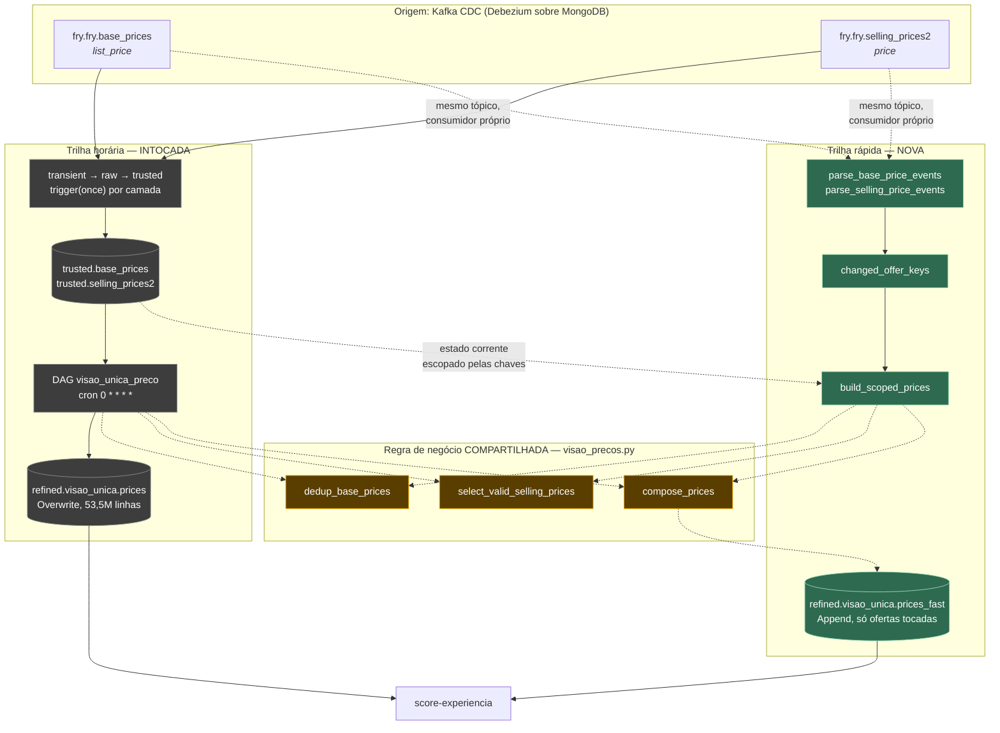
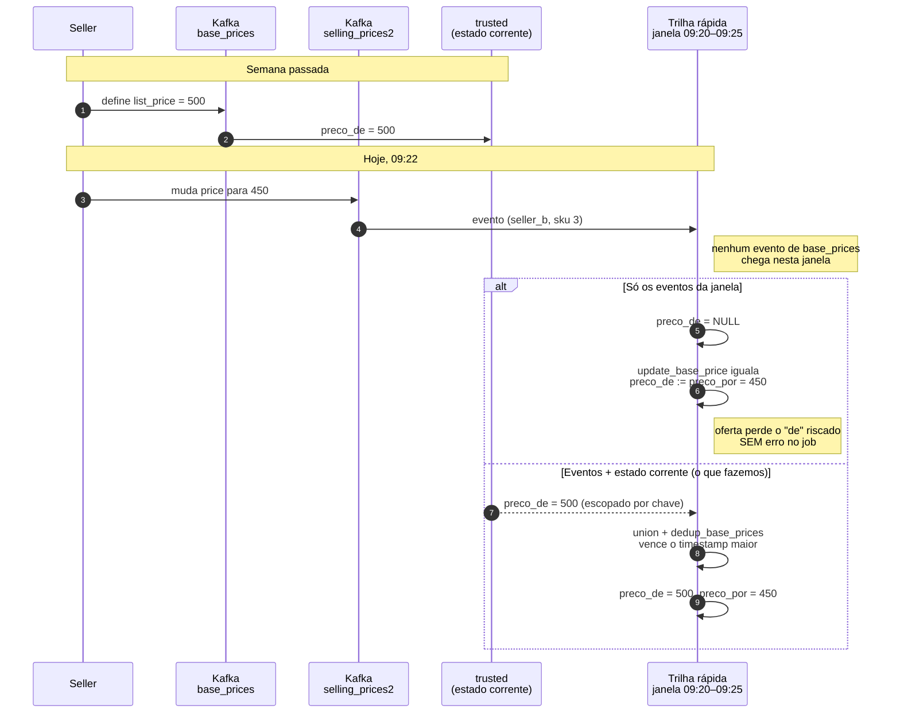
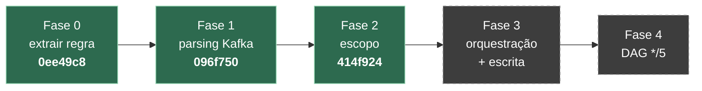

# Trilha rápida de preços

Documento de desenho da trilha incremental do `visao_unica_preco`. Descreve o que está sendo construído, o que muda no código que já existe, e as decisões que ainda precisam de vocês.

---

## 🎯 Por que

O score da experiência roda de 2 em 2 horas sobre a base inteira. Enquanto ele não roda, o site mostra ordenação calculada com preço velho. Para ele rodar de 5 em 5 minutos precisa de preço fresco, e é aí que a coisa trava: o preço vem de `refined.visao_unica.prices`, que é reconstruída por inteiro a cada hora.

Os números da reconstrução, lidos do Delta log de produção:

| | |
|---|---|
| Operação | `WRITE mode=Overwrite`, `partitionBy=[]` |
| Volume | 53.499.288 linhas, 150 arquivos, 2,81 GB |
| Por commit | `add=150 remove=150` — reescreve a tabela toda |
| Cadência | ~1h (14:38, 15:43, 16:40, 17:51, 18:34 UTC) |

E a `changed_prices`, que é o diff da mesma tabela, mostra que numa rodada mudam cerca de 200 mil ofertas. **Reescrevemos 53,5 milhões de linhas para aplicar 200 mil mudanças: razão de 267 para 1.** A hora não é o custo do cálculo, é o custo de reconstruir tudo.

Não existe versão desse desenho que rode em minutos. Apertar o cron só faz as execuções se sobreporem.

---

## 🧭 O que estamos construindo

Uma segunda trilha, **aditiva**, que lê os mesmos tópicos CDC direto do Kafka, compõe preço apenas das ofertas que mudaram na janela, e grava numa tabela nova. O pipeline horário continua exatamente como está e passa a servir de reconciliação.



O bloco amarelo é o ponto do desenho. **Nenhuma regra de preço vive na trilha rápida.** Ela faz parsing de evento e escopo, mais nada. Campanha nova, regra de cliente ouro, mudança de parcelamento — tudo entra no `compose_prices` e as duas trilhas herdam junto.

Isso não é preciosismo. Este repositório já tem o precedente do contrário: `treat_to_trusted` existe em três cópias no `fry_selling_prices2`, `treat_prices_to_trusted` em duas no `fry_base_prices`, e a detecção de mudança tem duas implementações diferentes (`get_changed_rows` no `visao_precos.py` e um SQL próprio no `publisher_changed_prices.py`). Duplicar cálculo de preço seria a versão cara desse mesmo erro.

---

## ⚠️ A armadilha central

`preco_de` e `preco_por` vêm de **coleções Mongo diferentes, em tópicos Kafka diferentes**:

```
fry.fry.base_prices      →  list_price   →  preco_de
fry.fry.selling_prices2  →  price        →  preco_por
```

Nada garante que cheguem juntos numa janela de 5 minutos. Um seller que mexe só no preço de venda gera evento em `selling_prices2` e silêncio em `base_prices`.



O caminho de cima é falha silenciosa: job verde, tabela escrita, oferta no site sem preço de referência.

Medindo num lote real da `changed_prices`: de 79.096 ofertas, 2,2% mudaram só o preço de venda. **Esse número subestima o risco**, por dois motivos. Primeiro, ele mede o diff da tabela composta, e o `compose_prices` acopla os dois campos (`preco_por = coalesce(preco_por, preco_de)`). Segundo, o diff é horário e colapsa eventos: uma oferta que muda o `list_price` às 10h05 e o `price` às 10h40 aparece como "mudaram os dois" na hora, mas são dois eventos separados numa janela de 5 minutos. Quanto mais fina a janela, maior a fração que chega com só um dos lados.

A trilha rápida resolve lendo o estado corrente da trusted escopado pelas chaves tocadas e sobrepondo os eventos novos. O `dedup_base_prices` desempata sozinho, ficando com o `timestamp_kafka` maior.

---

## 🔧 O que mudou no código existente

Três mudanças no `etls/trusted/visao_precos.py`, todas **preservando comportamento**, todas cobertas pelos testes que já existiam.

| Antes | Depois | Por quê |
|---|---|---|
| Composição embutida no `main()` | `compose_prices(prices, discounts, ouro, prazo, ...)` | O escopo passa a ser determinado pelo conteúdo de `prices`: catálogo inteiro reproduz o batch, subconjunto tocado dá o incremental |
| `get_base_prices` lia e transformava | `dedup_base_prices(df)` + `get_base_prices` só lê | A trilha rápida precisa aplicar a mesma regra sobre eventos do Kafka |
| `get_selling_prices` lia e transformava | `select_valid_selling_prices(df)` + `get_selling_prices` só lê | Idem |

Acrescentamos também a constante `PAYMENT_METHODS`, que hoje é literal duplicado entre a chamada de `get_arcoiro_campaigns` e a de `installment_prices_pivot`. Quando as duas listas divergem, colunas de parcelamento somem sem erro.

**Nenhum DAG existente foi tocado. Nenhuma cadência mudou. Nenhuma tabela existente mudou de schema.**

---

## 🧪 Como isso foi validado

O `visao_precos.py` tinha 65% de cobertura e quatro funções sem teste algum: `get_robinhood_campaigns`, `join_all_features`, `full_catalog` e `get_catalog_remove_inactive`. As três primeiras estão no meio da cadeia de composição, ou seja, exatamente onde a refatoração mexe.

Cobrimos as quatro **antes** de tocar em qualquer coisa. Cobertura foi para 82%, e o único trecho descoberto hoje é o corpo do `main()`.

Dois comportamentos não óbvios ficaram travados por teste, e valem menção porque são fáceis de quebrar sem perceber:

A precedência entre os lados do join **se inverte** de `join_all_features` (lado `a` ganha) para `full_catalog` (lado `b` ganha). E o `left_anti` do `get_catalog_remove_inactive` reordena as colunas, colocando as chaves do join na frente — quem assume que o `select` fixa a ordem se surpreende.

Os testes foram validados por mutação, não só por passarem. Removendo a chamada de `update_base_price` no fim do `compose_prices`, o teste correspondente falha com 5 ofertas de `price_de` menor que `price_por`. Trocando o `inner` do escopo por `left`, dois testes de escopo falham. Teste que não reprova quando o código quebra não é rede de segurança.

---

## 📍 Estado



Branch `feat/visao-unica-fast-path-precos`, saindo de `feat/visao-unica-compose-prices`. 83 testes verdes.

Cada fase seguiu red/green/refactor: teste escrito e **visto falhar** antes da implementação. Uma ressalva de honestidade: dois testes de contrato da Fase 1, os que alimentam o `dedup_base_prices` com a saída do parser, passaram de primeira. Verificam uma integração que a implementação já satisfazia, então são teste de contrato escritos depois, não TDD estrito.

---

## 🤔 O que precisamos de vocês

**O nome da tabela.** `refined.visao_unica.prices_fast`, append, particionada por dia, no contrato de 22 colunas do `compose_prices`. É o que o `score-experiencia` vai consumir por join em `(seller_id, sku)`. Se o nome ou o modo não servirem, é agora.

**A leitura da trusted na Fase 3.** A trilha rápida vai ler `trusted.visao_unica.base_prices` e `selling_prices2` escopadas pelas chaves tocadas, para resolver o problema do `preco_de`. É leitura pura, não muda nada no pipeline horário, mas é o único ponto onde a trilha nova toca uma tabela que o batch também usa. Queríamos isso explícito e não implícito.

**A medição direta, se acharem que muda alguma decisão.** Dá para contar quantas ofertas têm evento em `selling_prices2` sem evento em `base_prices` na mesma janela de 5 minutos, olhando as duas tabelas trusted por partição recente. O desenho já contempla o pior caso, então isso dimensiona o problema mas não altera a solução.

---

## 🐛 Coisas que encontramos no caminho

Nenhuma delas foi corrigida aqui, para não misturar escopo. Ficam registradas.

**`parse_timestamp_in_micro` mente no nome.** Usa `from_unixtime`, que espera **segundos**. Quem descreve a realidade é o nome da variável no `trusted_selling_prices2` (`cols_with_timestamp_in_seconds`). Se a trilha rápida tivesse assumido microssegundos, `start_at` e `end_at` sairiam com anos negativos, o filtro de validade nunca casaria e nenhuma oferta promocional entraria — silenciosamente.

**Duas implementações de detecção de mudança.** `visao_precos.py:get_changed_rows` grava a tabela; `publisher_changed_prices.py` faz um SQL próprio para o PubSub. Lógicas distintas, mesma intenção. A tabela e o tópico podem discordar.

**O payload do PubSub não bate com a detecção.** O `WHERE` compara sete campos incluindo `price_por_ouro` e `price_pix_ouro`, mas `payload_cols` em `serialize_message` omite os dois. Mudança só nos preços ouro publica mensagem com payload idêntico.

**Remoção de oferta não gera evento.** O join é `from ultimate_price_list left join penultimate_price_list`. Oferta que existia e sumiu nunca aparece, e nenhum consumidor descobre.

**`changed_prices` está 99,2% vazia.** Num arquivo de 10 milhões de linhas, 79.096 têm `seller_id`. O resto são eventos de campanha expirada com **todas** as colunas identificadoras nulas — sem sku, sem preço, sem canal. Não dá para saber qual campanha expirou de qual oferta. A tabela é append-only, já em 27 GiB, crescendo a ~660 milhões de linhas por dia.

**`black --check` já falha no `main`.** O `publisher_changed_prices.py` está fora de formatação, então o job `analysis-gcp-visao_unica_preco` reprova por motivo alheio a esta mudança.

**O README deste pipeline está desatualizado.** Afirma schedule `25 * * * *` em duas linhas (38 e 780); o DAG está em `0 * * * *`.
