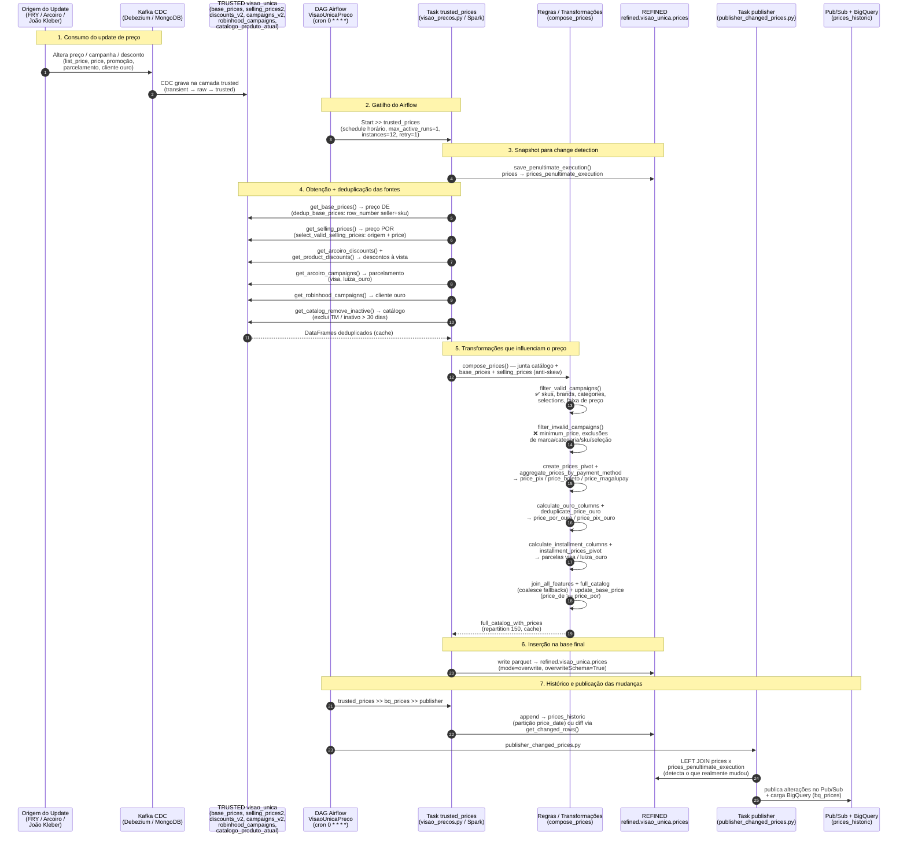

# Diagrama de Sequência — Ciclo de Vida de um Update de Preço

Fluxo completo de uma alteração de preço de e-commerce até a base final
`refined.visao_unica.prices`, cobrindo consumo do update, DAGs do Airflow,
transformações que influenciam o preço e a inserção na base final.

## Fluxo resumido

1. **Consumo** — Uma alteração de preço/campanha nasce nas origens (FRY, Arcoiro,
   João Kleber) e chega via CDC (Kafka/Debezium) às tabelas `trusted.visao_unica.*`.
2. **Gatilho** — A DAG `VisaoUnicaPreco` (cron `0 * * * *`) dispara a task
   `trusted_prices` a cada hora.
3. **Snapshot** — Antes de recompor, a execução anterior é salva em
   `prices_penultimate_execution` para detecção de mudança.
4. **Fontes** — São lidas e deduplicadas as bases de preço DE/POR, descontos,
   campanhas de parcelamento, campanhas cliente ouro e o catálogo ativo.
5. **Transformações** — `compose_prices()` aplica as regras de elegibilidade
   (inclusão/exclusão), calcula preços por forma de pagamento, preço ouro e
   parcelamento, e consolida com fallbacks via `coalesce`.
6. **Inserção** — O catálogo final é gravado em `refined.visao_unica.prices`
   (overwrite) e no histórico.
7. **Publicação** — O `publisher` compara com a execução anterior e publica no
   Pub/Sub + BigQuery apenas o que realmente mudou.
